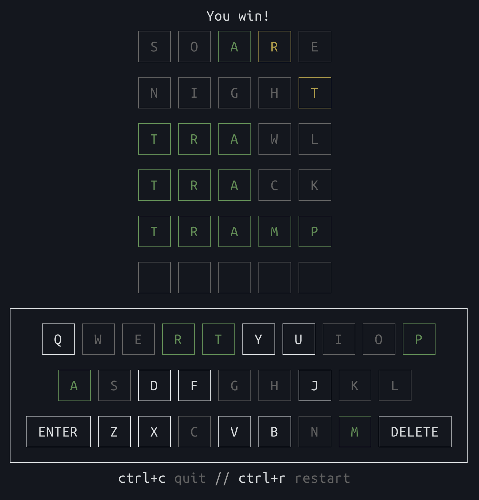

> [!NOTE]
> **This is a test fixture, not the real project.**
> `dispatrick/clidle-test` is a clone of [`ajeetdsouza/clidle`](https://github.com/ajeetdsouza/clidle)
> used purely as a sandbox for testing [Dispatch](https://upsun.com). It exists so we
> have a small, real-feeling Go codebase to open throwaway pull requests against.
> It is not maintained, not deployed, and not affiliated with the upstream author.
> All credit for the actual game goes to the original project (MIT licensed — see `LICENSE`).

<div align="center">

# clidle

**Wordle, now over SSH.**



**Try it:**

```sh
ssh clidle.duckdns.org -p 3000
```

**Or, run it locally:**

```sh
go install github.com/ajeetdsouza/clidle@latest
```

</div>

## How to play

You have 6 attempts to guess the correct word. Each guess must be a valid 5 letter
word.

After submitting a guess, the letters will turn green, yellow, or gray.

- **Green:** The letter is correct, and is in the correct position.
- **Yellow:** The letter is present in the solution, but is in the wrong position.
- **Gray:** The letter is not present in the solution.

## Languages

The game ships in English (default) and Welsh:

```sh
clidle --lang=cy
```

| Code | Language |
| ---- | -------- |
| `en` | English (default) |
| `cy` | Cymraeg (Welsh) |

An unrecognised code prints a warning and falls back to English.

For Welsh in this first release:

- Digraphs (`ll`, `dd`, `ff`, `ng`, `rh`, …) count as **two letters** and take
  up two tiles, so `bwrdd` is a five-letter word.
- Words needing a to-bach or any other accent are **not** included yet; the
  word lists are limited to plain `a`–`z`.

See [`data/README.md`](data/README.md) for the word lists and their provenance.

## Scoring

Your final score is based on how many guesses it took to arrive at the solution:

| Guesses | Score |
| ------- | ----- |
| 1       | 100   |
| 2       | 90    |
| 3       | 80    |
| 4       | 70    |
| 5       | 60    |
| 6       | 50    |
